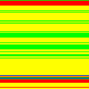
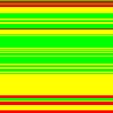

# Adaptive selection: how this encoder picks a filter per row

## Modes, not extra filter bytes

The encoder offers fixed filters and per-row selection modes:

| Mode | Behaviour |
| --- | --- |
| NoFilter / Sub / Up / Avg / Paeth | Use that filter on every row |
| Adaptive (default) | Minimise the sum of signed residual magnitudes |
| MinEntropy | Minimise an estimated entropy cost |

The adaptive modes still write one of the **five standard filter bytes**.
They do not add new filter types to the PNG format.

## The shared search

Both modes evaluate **up to four candidates**; only the score differs:

```text
for each scanline:
    best_cost = infinity
    for f in [Up, Sub, Avg, Paeth]:
        residuals = predict(f, row, previous_row)
        cost = score(residuals)
        if cost <= best_cost:
            best_filter, best_cost = f, cost
            if cost == 0: break
    regenerate the winner's residuals if overwritten
    write the chosen filter byte, then its residuals
```

- **None is not tested** by these two modes.
- Equal **nonzero** costs favour the later candidate: Paeth over Avg over Sub
  over Up. At cost zero, the **first zero-cost candidate wins** immediately.
- A full search can make **five prediction passes**: four trials and one
  regeneration. Scoring adds work too; this is not a fixed 4× time penalty.

## Heuristic 1 (default): minimum sum of absolute differences

`Adaptive` reinterprets residual bytes as signed values and adds their absolute
magnitudes—the **MSAD** heuristic recommended as one approach in
[spec §12.7](https://www.w3.org/TR/png/#12Filter-selection).

```text
stored bytes:       [2, 0, 254,  128]
signed values:      [2, 0,  -2, -128]
sum of magnitudes:  2 + 0 + 2 + 128 = 132
```

Small signed differences often indicate a useful prediction. But this score
does not model repeated sequences or the final DEFLATE output: **the lowest
score need not produce the smallest file**.

Here, cost zero means all residuals are zero: perfect prediction.

## Heuristic 2: minimum estimated entropy (`MinEntropy`)

`MinEntropy` scores the **distribution** of residual bytes rather than their
magnitude:

1. Skip aligned all-zero 8-byte chunks, treating them as free **in the score**.
2. Count the remaining bytes in a histogram.
3. Estimate their entropy with integer arithmetic.

Zero chunks still cost space in the real file. This is another proxy, not a
DEFLATE simulation: Huffman coding follows LZ77, which changes the symbol stream.

**Zero entropy cost does not mean perfect prediction.** A constant residual row
`[5, 5, 5, 5]` also scores zero and triggers the search's early exit.

### Measured tradeoff on four photos

From the same saved five-run experiment used on the next page:

| Image | File size vs Adaptive | Prediction time vs Adaptive |
| --- | ---: | ---: |
| kodim02 | −0.166% | 4.4× |
| kodim07 | −0.009% | 4.7× |
| kodim17 | −0.252% | 5.0× |
| kodim23 | +0.079% | 4.2× |

Slightly smaller on three photos, slightly larger on one; prediction was much
slower. These measurements do not establish a general size advantage.

## Seeing the choices

Each coloured row records **one choice for the whole scanline**:

| 128×128 RGBA icon | Adaptive | MinEntropy |
| :---: | :---: | :---: |
|  |  |  |

Legend: **black = None, red = Sub, green = Up, blue = Avg, yellow = Paeth**.
These are filter labels, not an error heatmap.

The [appendix](05-reference.md#adaptive-search-and-scoring) contains API defaults,
source links, and the entropy formula; [measurement scope](05-reference.md#measurement-scope)
explains the timing limits.

Next: reuse the previous row's choice when its MSAD cost is already small.
