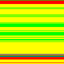
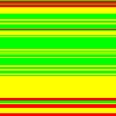
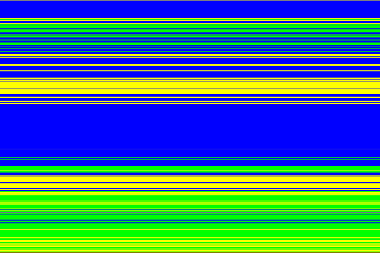

# Seeing the choices: the debug filter harness

This repo adds a small debug facility (local commits `7bc5cec` "first harness"
and `3fa225c` "refined" — not upstream) that records **which filter was chosen
for every scanline**, plus an example program that visualizes it.

## 1. The encoder-side debug output

Opt in on the `Encoder`, then read the log back from the `Writer` /
`StreamWriter`. Internally, every place a filter byte is written also records
it, so the log holds **one spec filter-type byte (0–4) per scanline**, in row
order for normal images, in Adam7 pass order for interlaced ones.

<details class="impl-ref" open>
<summary>Implementation reference</summary>

```rust
// on Encoder:
pub fn set_filter_log(&mut self, on: bool);      // src/encoder.rs L352 — opt in
pub fn set_filter_timing(&mut self, on: bool);   // L364 — opt in

// on Writer / StreamWriter:
pub fn filter_log(&self) -> Option<&[u8]>;       // Writer: L640, StreamWriter: L1701
pub fn filter_time(&self) -> Option<Duration>;   // Writer: L649, StreamWriter: L1710
```

Internally: `Options.filter_log: bool` (L174–175) → `Writer::new` creates
`filter_log: Option<Vec<u8>>` (L619, field L529–530) → every filter-byte write
also calls `record_filter(filter_type)` (L653–657), which pushes
`filter_type as u8`:

- stored (no compression) branch: records `NoFilter` — `src/encoder.rs` L1038
- fdeflate branch: L1061
- flate2 branch: L1107
- streaming `StreamWriter::write`: L2025
- stored fallback inside the fdeflate branch: L1080–1083 — **not** recorded
  (the known gap below)

Timing mirrors the log: `Options.filter_timing` (L178) → `Writer::new` creates
`filter_time: Option<Duration>` (L620, field L532) → each `filter(...)` call is
bracketed by `Instant::now()` and `record_filter_time` (L659–663): fdeflate
L1055–1059, flate2 L1102–1106, streaming L2011–2022. The stored branches do no
prediction, so they contribute no filter time.

All `src/encoder.rs` line numbers above are from this checkout — local commits
`7bc5cec` / `3fa225c`, not upstream.

</details>

> **Warning — known gap:** in the `FdeflateUltraFast` branch, if the compressed
> output would be larger than stored, the encoder falls back to writing raw rows
> with filter byte `0` — but that fallback path does **not** call
> `record_filter`. In that corner case the log is shorter than the number of
> scanlines.

## 2. The harness: `examples/filter_harness.rs` + `harness/run_harness.sh`

```bash
# from the repo root:
harness/run_harness.sh [--out DIR] [--mode MODE | --sweep] [--repeat N] IMAGE [IMAGE...]
# or directly:
cargo run --release --example filter_harness -- [--repeat N] <input.png> [output_dir] [mode]
# mode: none sub up avg paeth adaptive (default) minentropy sweep   (also: $FILTER_MODE)
```

`--sweep` runs every mode and gives each its own subfolder, so one command
produces the whole comparison. `--repeat N` encodes each mode N times and
reports the minimum, which smooths out timing noise.

For each mode it:

1. decodes the input (8-bit gray/gray+alpha/RGB/RGBA, non-interlaced preferred),
2. encodes it with the chosen mode, **filter log and filter timing switched on**,
   reading both back from the writer,
3. **decodes the result and verifies the round-trip** so the debug map can't lie,
4. exports into `<out>/`:

```text
<out>/
  times.json           encoding times, one entry per mode (see below)
  encoded.png          image encoded with the selected mode
  decoded.png          decoder output, re-encoded with NoFilter (plain lossless copy)
  summary.json         {"mode": ..., "encoded_bytes": ..., "bits_per_pixel": ...}
  debug/
    filter_map.png     one row per scanline: its color = the filter chosen for it
    filters.json       [{"row": 0, "filter_id": 4, "filter_name": "paeth"}, ...]
```

When sweeping, the per-mode files above live in `<out>/<mode>/` and only
`times.json` sits at the top:

```text
<out>/
  times.json
  none/      encoded.png decoded.png summary.json debug/...
  sub/       ...
  ...
  minentropy/ ...
```

### What `times.json` contains

```json
{
  "input": "tests/benches/tango-icon-...png",
  "width": 128, "height": 128, "repeat": 3, "aggregate": "min",
  "modes": [
    {
      "mode": "adaptive",
      "encoded_bytes": 12581, "bits_per_pixel": 6.1431,
      "runs": [
        {"encode_total_ns": 1111996, "filter_prediction_ns": 26003},
        {"encode_total_ns": 1129999, "filter_prediction_ns": 26013}
      ],
      "encode_total_ns": 1111996, "encode_total_ms": 1.111996,
      "filter_prediction_ns": 25994, "filter_prediction_ms": 0.025994,
      "filter_fraction": 0.0234
    }
  ]
}
```

- `encode_total_ns` — the **whole encode**: file creation, header, filtering,
  DEFLATE compression and IEND, measured in the harness around `encode()`.
- `filter_prediction_ns` — **only the filter prediction path**: each
  `filter(...)` call per scanline, measured inside the encoder through
  `Encoder::set_filter_timing`. Compression is excluded.
- The top-level numbers are the **minimum** across `runs`; median and mean are
  included as well. `filter_fraction` is `filter / total`.
- Timing costs two clock reads per scanline. Use the numbers to compare modes,
  not as absolute benchmark claims.

The color legend:

| filter byte | name | color in `filter_map.png` |
| ---: | --- | --- |
| 0 | none | ⬛ black |
| 1 | sub | 🟥 red |
| 2 | up | 🟩 green |
| 3 | avg | 🟦 blue |
| 4 | paeth | 🟨 yellow |

<details class="impl-ref" open>
<summary>Implementation reference</summary>

In `examples/filter_harness.rs` (local commits `7bc5cec` / `3fa225c`, extended
locally with timing and sweep): the log and timing are switched on at L150–151
and read back at L155–156, the round-trip is verified at L336–344, the color
legend (`filter_color`) is at L75–84, and `write_filter_map` errors out on
interlaced input (L175–181). Sweep selection is parsed at L217–231 and
`times.json` is written by `write_times_json` (L433–527).

</details>

## 3. Real output from this repo

### A 128×128 RGBA icon, all modes (`tests/benches/tango-icon-address-book-new-128-rsvg-convert.png`)

| mode | encoded bytes | bits/pixel |
| --- | ---: | ---: |
| none | 14 674 | 7.17 |
| sub | 15 628 | 7.63 |
| up | 13 101 | 6.40 |
| avg | 16 196 | 7.91 |
| paeth | 12 848 | 6.27 |
| **adaptive** | **12 581** | **6.14** |
| **minentropy** | **12 351** | **6.03** |

Adaptive beats every fixed filter — it gets to pick per row.

Source image vs. its filter map under `adaptive` vs. `minentropy`:





Read the maps row by row: flat background → green (Up); the book's horizontal
spine → red (Sub); detailed edges → yellow (Paeth).

### Timing the same icon (`--sweep --repeat 3`, minimum of 3 runs)

| mode | encode ms | filter prediction ms | filter % of encode |
| --- | ---: | ---: | ---: |
| none | 0.792 | 0.003 | 0.4 |
| sub | 1.080 | 0.004 | 0.4 |
| up | 0.971 | 0.004 | 0.4 |
| avg | 1.139 | 0.006 | 0.5 |
| paeth | 1.117 | 0.011 | 1.0 |
| **adaptive** | 1.112 | **0.026** | 2.3 |
| **minentropy** | 1.292 | **0.220** | 17.0 |

Two things to point out in the lecture:

- `none` still shows a few microseconds of "filter" time — that is the raw row
  copy plus the two clock reads per scanline, i.e. the measurement overhead
  itself.
- `adaptive` tries four predictors per row, so it is ~4× the fixed filters;
  `minentropy` is another ~8× on top because each candidate builds a 256-bin
  histogram. On a small icon that is a visible share of the encode; on the
  768×512 photo below the same adaptive path is only ~0.5% of the total,
  because DEFLATE dominates.

### A 768×512 photo (`tests/benches/kodim23.png`), adaptive mode

Filter distribution over its 512 rows (from `debug/filters.json`):

| filter | rows |
| --- | ---: |
| up | 129 |
| sub | 1 |
| avg | 270 |
| paeth | 112 |



(Generated maps live under `results/` — gitignored — e.g. `results/kodak_x4/`.)

## 4. Reading `filters.json` in a lecture

```json
{ "row": 0, "filter_id": 4, "filter_name": "paeth" }
```
One entry per scanline — you can `jq` it live, e.g.
`jq '[.filters[].filter_name] | group_by(.) | map({(.[0]): length}) | add' debug/filters.json`
to get the distribution table above.

> **Note:** `filter_map.png` requires non-interlaced input (one log entry per
> row); `write_filter_map` errors out otherwise.
